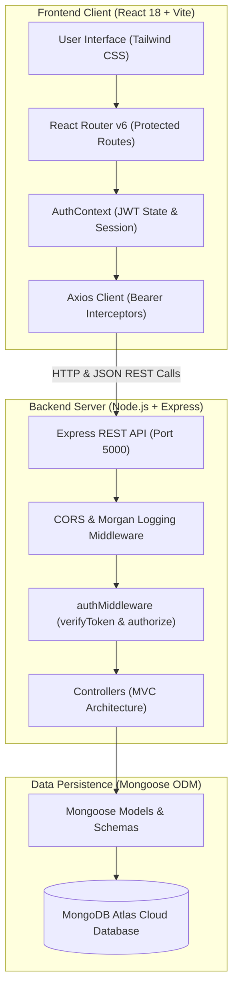
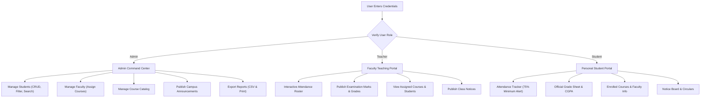
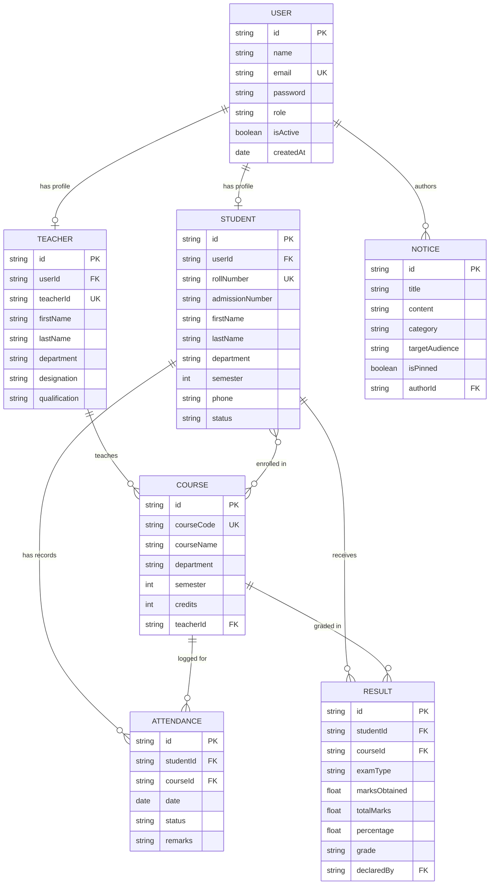
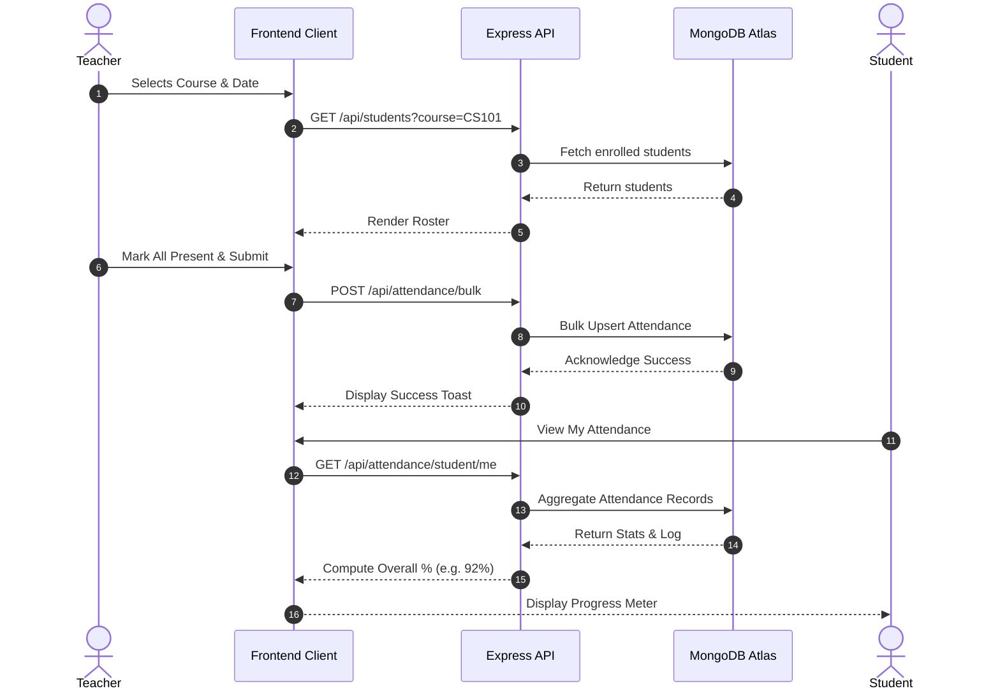

# EduTrack: Modern Student Management System (MERN Stack)

<div align="center">


[](https://www.mongodb.com/)
[](https://expressjs.com/)
[](https://react.dev/)
[](https://nodejs.org/)
[](https://tailwindcss.com/)
[](https://jwt.io/)
[](LICENSE)

An enterprise-ready, fully responsive, and modern **Student & Academic Management System** built with the **MERN Stack** (MongoDB, Express.js, React.js with Vite, and Node.js). Designed to streamline student admissions, faculty allocations, lecture attendance rosters, examination results with CGPA grading, and institutional notices.

[Live Demo](#-demo-login-credentials) • [Key Features](#-key-features) • [System Architecture](#-system-architecture) • [User Workflows](#-role-based-workflows) • [ER Diagram](#-database-entity-relationship-diagram) • [API Reference](#-api-endpoints) • [Quick Start](#-installation--quick-start)

</div>

---

## 📑 Table of Contents
- [Project Overview](#-project-overview)
- [System Architecture Flowchart](#-system-architecture)
- [Role-Based Workflows](#-role-based-workflows)
- [Database Entity-Relationship (ER) Diagram](#-database-entity-relationship-diagram)
- [Attendance & Examination Lifecycle](#-attendance--grading-lifecycle)
- [UI Showcase & Screenshots](#-ui-showcase--preview)
- [Key Features](#-key-features)
- [Technology Stack](#-technology-stack)
- [Demo Login Credentials](#-demo-login-credentials)
- [REST API Endpoints](#-api-endpoints)
- [Installation & Quick Start](#-installation--quick-start)
- [Deployment Guide](#-cloud-deployment)
- [Git & Version Control](#-git-commands)

---

## 🌟 Project Overview

**EduTrack** eliminates manual paperwork in colleges and academic institutions by centralizing administrative operations into an intuitive cloud-ready application:
- **Zero Configuration Fallback:** Automatically switches to an embedded in-memory MongoDB in development mode if a remote cluster is unreachable, ensuring smooth local testing.
- **Production Ready:** Pre-configured with Render Blueprint (`render.yaml`) for automated multi-service deployment.
- **Granular RBAC:** Complete isolation between **Admin**, **Teacher (Faculty)**, and **Student** privilege domains.

---

## 🏗 System Architecture

The following diagram illustrates the decoupled client-server architecture of EduTrack:



---

## 👥 Role-Based Workflows



---

## 🗄 Database Entity-Relationship Diagram



---

## 🔄 Attendance & Grading Lifecycle



---

## 📸 UI Showcase & Preview

| View | Description | Key Modules Featured |
| :--- | :--- | :--- |
| **Admin Command Center** | Real-time institutional overview | Total students, faculty counts, attendance benchmark, department distribution Recharts graph, recent registrations |
| **Interactive Attendance Roster** | Class attendance matrix | One-click "Mark All Present" button, per-student status toggles, custom remarks, instant bulk submission |
| **Examination & CGPA Sheet** | Academic grade management | Automatic percentage and letter grade calculation, 10-point GPA scale, printable official transcript |
| **Campus Notice Board** | Circular announcement feed | Category badges (*Urgent, Exam, Academic, Event*), priority indicators, pinned notices, audience targeting |

---

## 🚀 Key Features

### 1. Role-Based Access Control (RBAC)
- **Admin:**
  - Real-time statistics counters and graphical analytics.
  - Complete Student Directory with Search, Multi-Filter, Pagination, and Profile Modals.
  - Faculty directory with department allocation and workload assignment.
  - Course curriculum management with credit hours and teacher mapping.
  - Full institutional notice board control and CSV report generation.
- **Faculty / Teacher:**
  - Dedicated workspace with assigned courses and student rosters.
  - Daily lecture attendance marking with one-click bulk saving.
  - Publishing marks for Midterm, Final, Quiz, and Practical tests.
  - Broadcasting classroom circulars.
- **Student:**
  - Personalized attendance dashboard with a **75% minimum eligibility indicator**.
  - Certified academic transcript view with **Cumulative Grade Point Average (CGPA)**.
  - Course syllabus details with instructor info.
  - Digital notice bulletin with urgent exam alerts.

### 2. Security & Engineering Best Practices
- **JSON Web Tokens (JWT):** Secure stateless authentication with automatic 401 token refresh/logout interceptors.
- **Password Hashing:** Passwords hashed with `bcryptjs` (salt factor 10) and omitted from default query projections (`select: false`).
- **Compound Database Indexes:** Compound index `{ course: 1, student: 1, date: 1 }` prevents duplicate attendance records on the same day.
- **Clean Architecture:** Strict MVC separation (Models, Controllers, Routes, Middlewares, Services).

---

## 🛠 Technology Stack

### Frontend
- **Core:** React 18, Vite 6
- **Routing:** React Router DOM v6 (declarative & protected routes)
- **Styling:** Tailwind CSS v3.4 (custom design system in blue, white, and slate)
- **Data Visualization:** Recharts (Responsive Bar and Pie Charts)
- **Icons:** Lucide React
- **HTTP Client:** Axios (configured with request/response interceptors)

### Backend
- **Runtime:** Node.js (v18+)
- **Framework:** Express.js 4 (RESTful architecture)
- **Database ODM:** Mongoose 8
- **Authentication:** JWT (`jsonwebtoken`) & `bcryptjs`
- **Request Logging:** Morgan (in development mode)
- **CORS:** Configured for local & production origins

### Database & Cloud
- **Production Database:** MongoDB Atlas (M0 Shared Cloud Cluster)
- **Local Dev Fallback:** Embedded In-Memory MongoDB (`mongodb-memory-server`)
- **Hosting Platforms:** Render (Backend Web Service), Render / Vercel (Frontend Static SPA)

---

## 🔑 Demo Login Credentials

The application features **One-Click Quick-Fill Demo Buttons** directly on the sign-in screen:

| Role | Email Address | Password | Permissions & Scope |
| :--- | :--- | :--- | :--- |
| **👑 Admin** | `admin@sms.com` | `admin123` | Full control across all institutional modules |
| **👨‍🏫 Faculty** | `teacher@sms.com` | `teacher123` | Attendance roster, exam scores, assigned courses |
| **🎓 Student** | `student@sms.com` | `student123` | Personal attendance %, CGPA transcript, notices |

---

## 📡 REST API Endpoints

All authenticated routes require the standard header:
`Authorization: Bearer <your_jwt_token>`

### Authentication (`/api/auth`)
| Method | Endpoint | Access | Purpose |
| :--- | :--- | :--- | :--- |
| `POST` | `/api/auth/register` | Public | Register new student or teacher account |
| `POST` | `/api/auth/login` | Public | Authenticate user & return JWT token |
| `GET` | `/api/auth/profile` | Private | Retrieve authenticated user profile |
| `PUT` | `/api/auth/profile` | Private | Update personal profile & contact info |
| `PUT` | `/api/auth/change-password` | Private | Secure password modification |

### Students (`/api/students`)
| Method | Endpoint | Access | Purpose |
| :--- | :--- | :--- | :--- |
| `GET` | `/api/students` | Admin, Teacher | Paginated student directory with search |
| `POST` | `/api/students` | Admin | Enroll student & create login credentials |
| `GET` | `/api/students/:id` | Admin, Teacher, Student | Get detailed student profile |
| `PUT` | `/api/students/:id` | Admin, Teacher | Update student record |
| `DELETE` | `/api/students/:id` | Admin | Remove student and associated user |
| `GET` | `/api/students/profile/me`| Student | Student's own profile |

### Attendance (`/api/attendance`)
| Method | Endpoint | Access | Purpose |
| :--- | :--- | :--- | :--- |
| `GET` | `/api/attendance` | Admin, Teacher | Filter records by course and date |
| `POST` | `/api/attendance` | Admin, Teacher | Record single student attendance |
| `POST` | `/api/attendance/bulk` | Admin, Teacher | Submit class roster attendance at once |
| `GET` | `/api/attendance/student/me` | Student | Logged-in student's attendance history |

### Examination Results (`/api/results`)
| Method | Endpoint | Access | Purpose |
| :--- | :--- | :--- | :--- |
| `GET` | `/api/results` | Admin, Teacher | Filter results by course and exam type |
| `POST` | `/api/results` | Admin, Teacher | Publish examination marks & calculate grades |
| `GET` | `/api/results/student/me` | Student | Official certified grade transcript with CGPA |

---

## ⚡ Installation & Quick Start

### 1. Clone the Repository
```bash
git clone https://github.com/Priyanshu2647/student-management-system.git
cd student-management-system
```

### 2. Backend Setup
```bash
cd backend
npm install
```

Configure your `backend/.env` file:
```env
PORT=5000
NODE_ENV=development
MONGO_URI=mongodb+srv://<username>:<password>@cluster0.mongodb.net/student_mgmt?retryWrites=true&w=majority
JWT_SECRET=supersecret_jwt_key_student_management_system_2026_xyz
JWT_EXPIRE=30d
CLIENT_URL=http://localhost:5173
```
*(If `MONGO_URI` is left blank, the backend automatically spins up an in-memory database with pre-seeded demo records for instant local testing!)*

Start the backend:
```bash
npm run dev
# Server running at http://localhost:5000/api
```

### 3. Frontend Setup
In a new terminal window:
```bash
cd frontend
npm install
npm run dev
# Frontend live at http://localhost:5173
```

---

## 🌐 Cloud Deployment

### 1-Click Deployment with Render Blueprint
This repository includes a `render.yaml` blueprint.

1. Go to [Render Dashboard](https://dashboard.render.com/blueprints/new).
2. Select your repository: `Priyanshu2647/student-management-system`.
3. Click **Apply**: Render will automatically deploy:
   - **Backend Web Service:** `https://student-management-backend.onrender.com`
   - **Frontend Static Site:** `https://student-management-frontend.onrender.com`
   - Both are auto-connected via environment variables!

---

## 📦 Git Commands

```bash
# Check status
git status

# Stage changes
git add .

# Commit
git commit -m "feat: complete student management system with flowcharts and diagrams"

# Push to main
git push origin main
```

---

## 📄 License
Distributed under the MIT License. See `LICENSE` for details.
